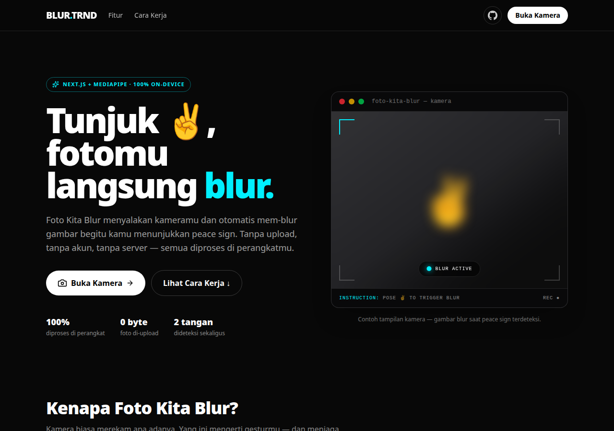
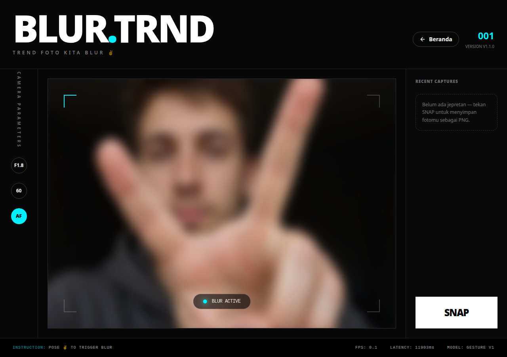
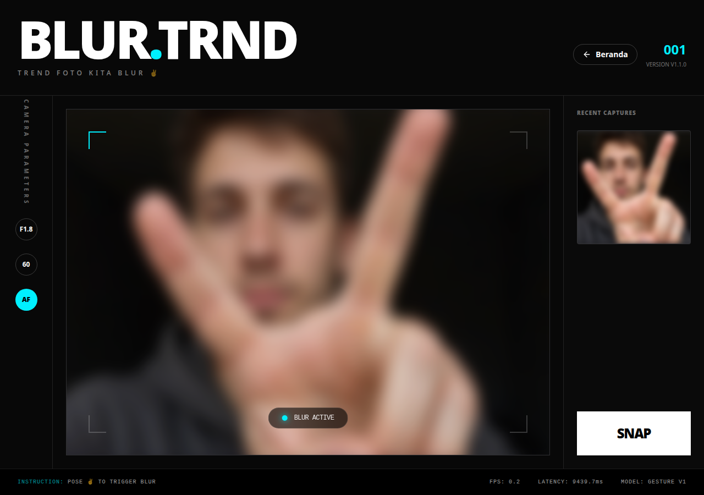

# Foto Kita Blur

Kamera web yang otomatis mem-blur gambar begitu kamu menunjukkan **peace sign (✌️)**.
Deteksi gesture real-time dengan MediaPipe — 100% diproses di perangkatmu, tanpa upload,
tanpa akun, tanpa server.

## 🌐 Live Demo

**https://blurkita.pages.dev**

## 🖼️ Tampilan







### 🎬 Video Demo

[](docs/demo/demo.mp4)

> Video direkam tanpa suara (headless). Feed kamera di video adalah **simulasi**
> (foto peace sign yang diumpankan sebagai kamera palsu, karena headless tidak
> punya kamera asli) — tapi blur yang terpicu adalah deteksi MediaPipe
> sungguhan: model membaca feed itu dan menyalakan blur saat melihat ✌️.
> [Tonton videonya](docs/demo/demo.mp4) (MP4, tanpa suara).

## ✨ Fitur

- **Deteksi gesture real-time** — MediaPipe Gesture Recognizer membaca tanganmu tiap
  frame; peace sign (kategori `Victory`, skor &gt; 0,55) langsung memicu blur.
- **Auto-blur instan** — gambar blur selagi ✌️ terlihat, kembali tajam saat tangan turun.
- **Jepret & simpan** — tombol SNAP mengunduh fotomu sebagai PNG. Apa yang terlihat di
  layar (termasuk blur-nya), itu yang tersimpan. Jepretan juga tampil di galeri
  "Recent Captures" dan bisa diunduh ulang.
- **Telemetri asli** — timer REC berjalan, FPS dan latensi inferensi diukur langsung
  dari loop kamera (bukan angka hardcode).
- **Dua tangan sekaligus** — sampai dua tangan dalam satu frame.
- **Privasi penuh** — frame kamera tidak pernah keluar dari perangkatmu.
- **Landing page SaaS** — navbar + logo GitHub, hero dengan preview kamera, fitur,
  cara kerja, dan footer.
- **Gratis & open source** — lisensi MIT.

## 🚀 Cara Pakai

1. Buka live demo, klik **Buka Kamera**.
2. Izinkan akses webcam saat browser meminta.
3. Tunggu model AI dimuat (diunduh sekali dari CDN saat pertama dibuka).
4. Tunjuk peace sign ✌️ ke kamera — gambar langsung blur.
5. Tekan **SNAP** untuk menyimpan fotomu sebagai PNG.

## 🛠️ Tech Stack

- **Next.js 15** (App Router, static export) + React 19 + TypeScript
- **MediaPipe Tasks Vision** — Gesture Recognizer (`gesture_recognizer`, float16)
- **Tailwind CSS 4**
- **Lucide** — ikon

## 📁 Struktur Proyek

```
app/
  layout.tsx        # Metadata + favicon
  page.tsx          # Saklar landing ↔ kamera
  globals.css       # Tailwind
components/
  LandingPage.tsx   # Landing page SaaS
  CameraStudio.tsx  # Kamera + deteksi gesture + SNAP
  GitHubIcon.tsx    # Logo GitHub (SVG)
docs/
  architecture.md   # Arsitektur & alur
  diagrams/app-flow.svg
  screenshots/      # Screenshot tampilan asli
  demo/demo.mp4     # Video demo
.github/workflows/ci.yml  # typecheck + build (job terpisah)
```

## 💻 Menjalankan Lokal

```bash
npm install
npm run dev      # http://localhost:3000
npm run typecheck
npm run build    # static export ke out/
```

Tidak butuh environment variable apa pun (lihat `.env.example`).

## 🔒 Privasi

Video diproses langsung di browser dengan MediaPipe — tidak ada satu frame pun yang
dikirim ke mana-mana. Model AI diunduh sekali dari CDN publik (jsDelivr &amp; Google
Storage) saat pertama kali kamera dibuka.

## 📄 Lisensi

MIT — lihat [LICENSE](./LICENSE).
